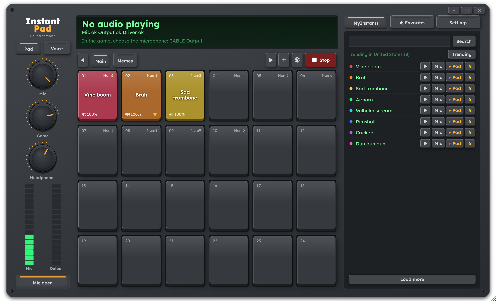
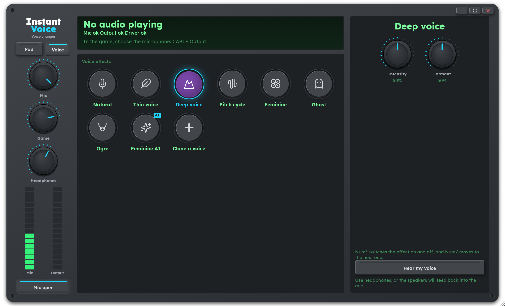
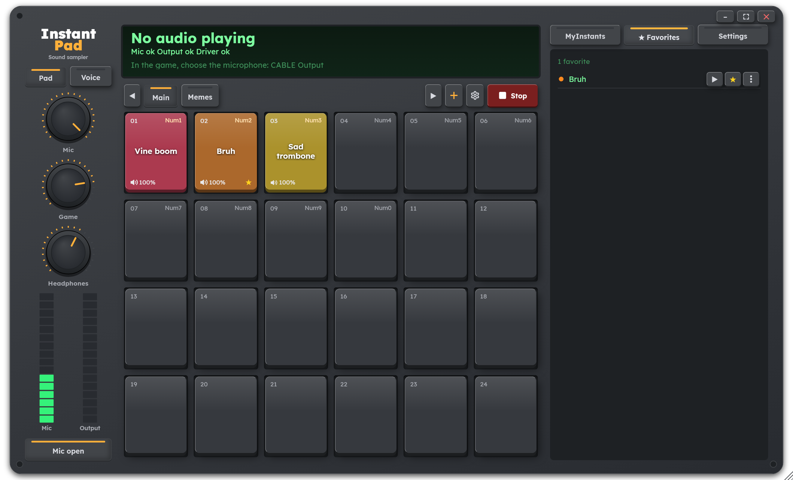
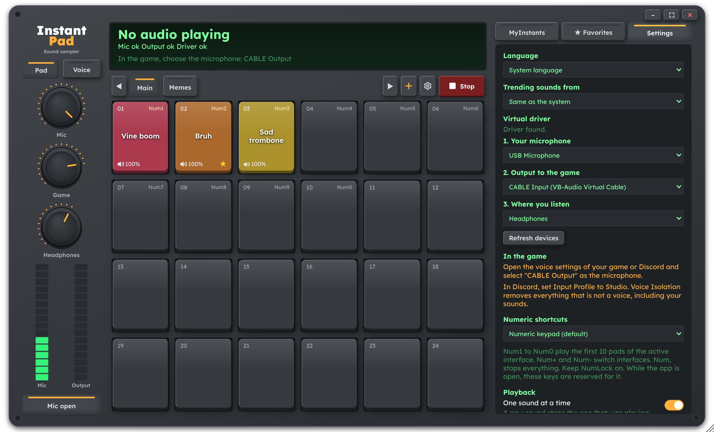

English | [Português](README.pt-BR.md)

<p align="center">
  <a href="assets/reel.mp4"></a>
</p>

# InstantPad

InstantPad is a free, open source soundboard for Windows, macOS and Linux. It looks like a hardware sampler and has the MyInstants library built in. It mixes your microphone with the sounds you trigger and sends the result to a virtual audio cable, which your game or Discord uses as its microphone. Your friends hear your voice and the sound together.



<p align="center">
  
  
  
</p>

## Install

### Why you need a virtual audio cable

Games and Discord only listen to microphones. A virtual audio cable works as a fake microphone: whatever an app plays into one end comes out of the other end as microphone input. InstantPad plays your voice and your sounds into the cable, and you pick the cable as the microphone in your game. On Windows and macOS the cable is a small driver that you install once. On Linux InstantPad creates it for you.

```
microphone ─┐
            ├─► InstantPad ─► virtual cable ─► game / Discord
sounds ─────┤
            └─► your headphones (sounds only)
```

Download the file for your system from the [latest release](https://github.com/eljonathas/InstantPad/releases/latest).

### Windows

1. Download the `.exe` setup and run it. The app is not code signed yet, so Windows may show a warning the first time. Click **More info**, then **Run anyway**.
2. When the setup has copied the app, it checks for VB-CABLE, the virtual cable, and offers to install it if it is missing. Click **Yes**. Windows asks for administrator rights, only for the driver, and the VB-Audio window opens: click **Install Driver**. VB-CABLE is donationware from [VB-Audio](https://vb-cable.com).
3. Choose **Reboot now** on the last page. The driver only works properly after a restart, and InstantPad opens by itself when you log in again.
4. VB-CABLE sets itself as the Windows output device when it installs. Open the Windows sound settings and choose your headphones as the output again. **Settings** shows a warning, with an **Open sound settings** button, while the output is still on the cable.

If you skipped the driver during setup, or removed it later, go to **Settings** and click **Install VB-CABLE**: it downloads the driver from the official VB-Audio site, checks its signature and opens its installer. Restart afterwards.

If you prefer not to install the app, download `InstantPad-portable.exe` instead. It runs on its own and does not update itself, and it has no setup, so install VB-CABLE from **Settings**.

### macOS

1. Download the `.pkg` installer that matches your Mac: `aarch64` for Apple silicon (M1 and newer), `x64` for Intel Macs.
2. InstantPad is not notarized yet, so macOS blocks the installer the first time. Open **System Settings**, go to **Privacy & Security** and click **Open Anyway**, then open it again.
3. Keep **BlackHole 2ch (virtual audio cable)** ticked in the installation type step. The installer downloads the official BlackHole package from Existential Audio, checks it and installs it with the app. The choice is greyed out when BlackHole is already installed.
4. Open InstantPad from Applications and allow the microphone when macOS asks.

You can also download the `.dmg` and drag InstantPad to Applications. Then install [BlackHole 2ch](https://existential.audio/blackhole/) yourself: the **Install BlackHole** button in **Settings** opens its download page, and **Refresh devices** finds it afterwards. InstantPad does not use VB-CABLE on macOS.

### Linux

1. Download the `.AppImage`, make it executable (`chmod +x` on the file, or the permissions option in your file manager) and run it.
2. InstantPad creates its own virtual cable, called `InstantPad_Mic`, through PulseAudio or PipeWire. It uses the `pactl` command, so `pactl` must be installed.

### Updates

InstantPad checks for a new version when it opens and downloads it in the background, verifying its signature. When the download is done, a window says so, once per version, with **Restart now** and **Later**. Tick the box in it to stop the window for good: the new version then waits in **Settings**, under **Update**, where the switch brings the window back. Either way the new version is applied when you close the app, or right away with **Restart now**. It never restarts by itself, so an update cannot interrupt a match.

## Set up your game or Discord

1. Open InstantPad and go to **Settings**. The **In the game** section shows the microphone to use: `CABLE Output` on Windows, `BlackHole 2ch` on macOS and `InstantPad_Mic` on Linux.
2. Under **1. Your microphone**, choose your real microphone. Under **3. Where you listen**, choose your headphones. **2. Output to the game** should already point to the cable.
3. In the voice settings of your game or Discord, select the cable as the microphone.
4. Play a pad and ask a friend if they hear it, or watch the input level in the voice settings.

If the game uses push-to-talk, hold the key while a sound plays, or switch to open mic.

In Discord, set **Input Profile** to **Studio**. Voice Isolation removes everything that is not a voice, including your sounds. If you use a custom profile, turn off noise suppression, echo cancellation and automatic gain control.

## Using it

| To | Do this |
| --- | --- |
| Play a sound | Click its pad or press its shortcut |
| Find sounds | Search MyInstants, or open **Trending**, which shows what is popular in your country. **Settings** can pick another country |
| Fill a pad | Click an empty pad, then **+ Pad** on a result, or drag a result onto the pad. The sound is downloaded and kept locally |
| Try an online sound on your headphones | The play button on the result (**Listen on your headphones only**) |
| Play an online sound in the game without saving it | **Mic** on the result (**Play in the game now**) |
| Mark a favorite | The star on a result, or right-click a pad and choose **Add to favorites** |
| Use your own files | Click the folder key next to the search and pick one or more files: they go to the pad you clicked and the next free ones. You can also drag files from your file manager onto a pad, or right-click a pad and choose **Load audio file...** |
| Save a copy of a sound elsewhere | Right-click its pad and choose **Download to computer...** |
| Change a pad's shortcut, volume, color or name | Right-click the pad |
| Rearrange pads | Hold Ctrl and drag |
| Stop everything | **Stop** |
| Fill the screen | The full screen key next to minimize, or `F11` |
| Turn a knob | Drag up or down, or use the mouse wheel. Double-click resets it. The exact value shows under the knob while you hold it |

The knobs set your voice in the game (**Mic**), the sounds in the game (**Game**) and the sounds you hear (**Headphones**).

Sounds on pads and favorites are kept on your computer. Sounds you only listened to go to a temporary folder, which InstantPad clears when it opens and when it closes. Your own files can be `.mp3`, `.wav`, `.m4a`, `.aac` or `.flac`. `.wma` is not supported.

Only one copy of the app runs at a time. Opening it again brings the existing window to the front.

### Interfaces

Create as many interfaces as you want with **+**. Each has its own name, color and grid, up to 8 rows by 10 columns. The gear button (**Configure this interface**) configures the current one, and right-clicking a tab moves or deletes it.

### Cutting a sound into pads

The scissors key cuts a sound into pieces, each on a pad of its own, the way the hot cues of a DJ player split a track. It is on every MyInstants result, next to the folder for a file of the computer, and in the right-click menu of a pad. The file is never changed: each pad plays its piece of it.

- **Detect cuts** marks a cue at the start of each sound after a pause, which splits a compilation of effects at once.
- Click the waveform to move the playhead, and press **C** or double-click to mark a cue there. Drag a cue to move it, or nudge the selected one with the arrows; **Delete** removes it.
- **Space** plays from the playhead, and **1** to **9** play each piece. The wheel zooms, and Shift with the wheel moves along the sound.
- Name the pieces, untick the ones you do not want, and **Create** puts them on the free pads of the interface on screen. Pads that have a sound are never replaced.

### Voice effects

The **Voice** key under the logo opens InstantVoice, where you change your own voice in calls and games. Click an effect to turn it on, and its knobs appear on the right. **Natural** turns effects off. The effect stays on when you go back to **Pad**, and the LED on the **Voice** key shows that it is running.

| Effect | Knobs |
| --- | --- |
| Thin voice | **Intensity** and **Formant** |
| Deep voice | **Intensity** and **Formant** |
| Pitch cycle, which rises to a high pitch and falls to a low one | **Time**, **High** and **Low** |
| Feminine, a higher voice with lifted resonances and highs | **Intensity** and **Formant** |
| Ghost, a breathy whisper with a hollow echo | **Whisper**, **Echo** and **Pitch** |
| Ogre, a low, growling voice | **Intensity**, **Growl** and **Formant** |
| Feminine AI, which changes the timbre of your voice with AI | **Pitch** |
| Each voice you clone | **Pitch** |

Turn on **Hear my voice** to try an effect on your headphones. Use headphones for this, because speakers feed back into the mic.

An effect delays your voice by about 40 ms. **Natural** adds no delay.

### AI voices

**Feminine AI** and cloned voices run an AI model on your own computer. Nothing you say leaves it. The first time, the app downloads the models, about 180 MB, and the AI learns your own voice by itself: the first time you pick an AI voice, it listens while you talk for a few seconds, with nothing to record, and the voice comes on when it is done. If the first time was in a noisy room or on another microphone, **Learn my voice again** does it again. An AI voice delays your voice by about a third of a second, and it needs a recent processor. If your computer cannot keep up, the app warns you and keeps only the pitch part of the effect.

### Cloning a voice

The **+** key after the effects clones a voice, so you can speak with it in calls and games:

1. You record 20 seconds to 5 minutes of natural speech, alone in a quiet room, or pick an audio file of the voice.
2. You name the voice.

The app keeps only the voiceprint. The recording itself is never stored. Select a cloned voice and click **Delete voice** to remove it at any time.

The app does not check who a voice belongs to, so clone only your own voice or one whose owner agreed. Using someone's voice to pass yourself off as them can be a crime, and it is on you.

#### Tips for a good clone

How good the clone sounds depends almost entirely on the sample. Record in a quiet room with no echo, with the microphone you call with a hand's width from your mouth. Speak naturally and let your tone move, as you would in a conversation. One to three minutes of speech is ideal, and under 30 seconds leaves the voice thin. If you use a file, pick one without background music or heavy compression, because voice messages from chat apps lose detail. When you use the voice, let the AI learn your own voice on the same microphone and turn the **Pitch** until it is close to the cloned voice. The AI copies the timbre, but the pace and the way of speaking are still yours.

### Designing a voice

Once you have a cloned voice, the key after **Clone a voice** designs new voices from it. Pick the cloned voice to start from, move the **Timbre** toward a deeper or a higher voice, and mix in another cloned voice if you want. Turn on **Hear preview** to try it on your headphones while you adjust, then name it and save. A designed voice keeps only its recipe, so deleting a cloned voice also deletes the voices designed from it.

Start with a small blend, between 20% and 40%, and change the timbre a little at a time while you listen to the preview.

### Trained voices

For a voice that sounds far more like the original, train a model of it on your computer with the kit in [`tools/voice-training`](tools/voice-training/README.md), which uses RVC. It takes about an hour on an NVIDIA graphics card, on Windows through WSL, and more than a day on the processor. Then pick **Feminine AI** or a cloned voice and click **Add a trained model...**, and choose the folder the kit exported.

The voice now has two engines, and **Engine** switches between them:

- **Trained** speaks through the model. It needs no learning of your voice, and moves your pitch to the voice's by itself; **Pitch** moves it further, up to an octave either way. It answers in about half a second and needs a fast processor. If your computer falls behind, the app tells you to switch to Instant.
- **Instant** is the AI voice as before.

**Replace model...** adds a newer training, and **Remove model** takes it off. The first model you add brings HuBERT, about 380 MB, which every trained voice shares.

### Playback options

**Settings** has two playback options:

- **One sound at a time**: a new sound stops the one that was playing. It is on in new installs. An update keeps the choice you already had.
- **Press again to stop**, off by default: pressing a pad that is playing stops it instead of starting it over. Its shortcut does the same.

Each pad with a sound shows its volume in the bottom left corner. Right-click the pad and choose **Volume** to change it. On dense grids the pad drops the `%`. On narrow pads the number and shortcut give their row to the name. Hover the pad to see its shortcut and volume in full.

### Numeric shortcuts

These are on by default and work while a game has focus:

| Key | Action |
| --- | --- |
| `Num1` to `Num9`, `Num0` | The first 10 pads of the active interface |
| `Num+` / `Num-` | Next / previous interface |
| `Num,` | Stop everything |
| `Num*` | Turn the voice effect on or off |
| `Num/` | Next voice effect |

**Settings** can switch them to `Ctrl` plus the numeric keypad, or `Alt` plus `1` to `0`, or turn them off. Keep NumLock on. A shortcut you set on a pad takes priority over these.

### Language

The app follows your system language and comes in English and Portuguese. You can change it in **Settings**, under **Language**.

## Troubleshooting

If the sound is robotic, distorted or missing on Windows, first check whether it reaches the cable. Open the Windows sound panel, go to **Recording** and watch the level bar of `CABLE Output` while a pad plays. If the bar moves, the problem is in the game or Discord settings. If it stays still, the problem is on the PC.

Check these in order:

1. Did you restart the PC after installing VB-CABLE? Windows shows the driver as working before the restart, but it is not.
2. In Device Manager, look for a `VB-Audio Virtual Cable` entry with an error. If there is one, or if the Windows audio service keeps stopping, reinstall the driver: run `VBCABLE_Setup_x64.exe` as administrator, click **Remove Driver**, restart, run it again, click **Install Driver**, and restart.
3. The system output device must be your headphones, not the cable. Otherwise every app on your PC goes into your microphone.
4. Bluetooth headsets drop to call quality whenever an app uses their microphone. Use a wired or USB microphone, and make sure Discord and your game are not reading the headset's mic.
5. Right-click `CABLE Input` and `CABLE Output` in the Windows sound panel and check that both use the same sample rate. VB-CABLE distorts when they differ. 48000 Hz works well.
6. Lower the **Mic** and **Game** knobs until the meter stays out of the red.

Other cases:

- **Settings** says no virtual cable was found: on Windows and macOS, install it as described above. On Linux, check that `pactl` is installed.
- A device you just plugged in is missing from the lists: click **Refresh devices** in **Settings**.
- A shortcut does nothing while a game runs as administrator: run InstantPad as administrator too.

## Development

You need Rust, Node 22 and pnpm. On Linux you also need the [Tauri system libraries](https://tauri.app/start/prerequisites/).

```bash
pnpm install
pnpm dev
```

[CONTRIBUTING.md](CONTRIBUTING.md) covers the project layout, tests and commit conventions. [docs/architecture](docs/architecture/README.md) explains how the code is organized.

## Limitations

On Windows the virtual device is VB-CABLE, from VB-Audio. Windows only loads audio drivers signed by Microsoft, so the app cannot create its own. It downloads the setup from the official site and runs it only if the digital signature belongs to VB-Audio. VB-CABLE is free, with an optional donation.

On macOS the app and its installer are not notarized, so macOS asks you to allow them the first time. The `.pkg` installer downloads BlackHole for you; with the `.dmg` you install it yourself.

MyInstants has no public API, so the app reads the site's HTML. If the site changes, [`parser.rs`](crates/catalog/src/parser.rs) is the file to fix.

A game running as administrator can block global shortcuts. If that happens, run InstantPad as administrator too.

Some keys of Brazilian ABNT2 keyboards, such as the `/` next to the right Shift, cannot be global shortcuts on Windows.

The virtual cable on Linux stays after you close the app, until you log out, and the next start reuses it.

The AI voices run on Windows, macOS and 64-bit Intel or AMD Linux, on the processor only. They are not available on ARM Linux.

## License

[MIT](LICENSE). The app uses the [Lexend](https://www.lexend.com/) font under the [SIL Open Font License](apps/desktop/src/shared/styles/fonts/OFL.txt).

The AI voices download these models, which are not part of the app:

- [ONNX Runtime](https://onnxruntime.ai) by Microsoft, under the MIT License.
- The tone color converter of [OpenVoice V2](https://github.com/myshell-ai/OpenVoice) by MyShell, under the MIT License, in the [ONNX export by Hinotsuba](https://huggingface.co/Hinotsuba/OpenVoice-ONNX-v2).

The voice of **Feminine AI** is the average of ten speakers of [LibriSpeech](https://www.openslr.org/12) (Panayotov et al., CC BY 4.0), so it is nobody's voice in particular.
