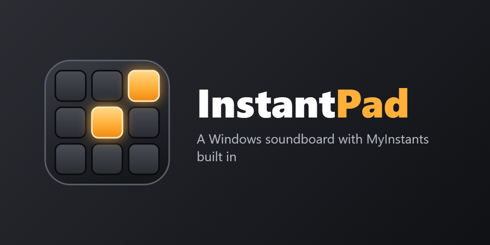
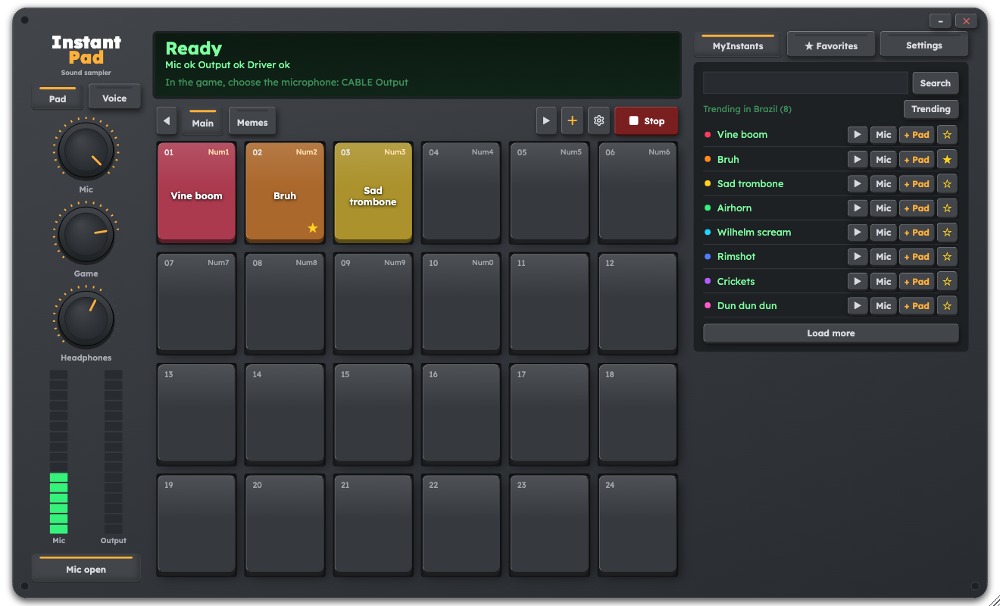

English | [Português](README.pt-BR.md)

<p align="center">
  
</p>

# InstantPad

InstantPad is a free, open source soundboard for Windows, macOS and Linux. It looks like a hardware sampler and has the MyInstants library built in. It mixes your microphone with the sounds you trigger and sends the result to a virtual audio cable, which your game or Discord uses as its microphone. Your friends hear your voice and the sound together.



## Install

### Why you need a virtual audio cable

Games and Discord only listen to microphones. A virtual audio cable works as a fake microphone: whatever an app plays into one end comes out of the other end as microphone input. InstantPad plays your voice and your sounds into the cable, and you pick the cable as the microphone in your game. On Windows and macOS the cable is a small driver that you install once. On Linux InstantPad creates it for you.

```
microphone ─┐
            ├─► InstantPad ─► virtual cable ─► game / Discord
sounds ─────┤
            └─► your headphones (sounds only)
```

Download the file for your system from the [latest release](https://github.com/eljonathas/InstantPad/releases/latest).

### Windows

1. Download the `.exe` setup and run it. It installs for your user and does not ask for an administrator password. The app is not code signed yet, so Windows may show a warning the first time. Click **More info**, then **Run anyway**.
2. Open InstantPad, go to **Settings** and click **Install VB-CABLE**. InstantPad downloads the driver from the official VB-Audio site and opens its installer. Click **Install Driver** in that window.
3. Restart your PC. Windows reports the driver as working before the restart, but it does not work properly until you restart.
4. VB-CABLE sets itself as the Windows output device when it installs. Open the Windows sound settings and choose your headphones as the output again. **Settings** shows a warning, with an **Open sound settings** button, while the output is still on the cable.

If you prefer not to install the app, download `InstantPad-portable.exe` instead. It runs on its own and does not update itself. You still need VB-CABLE, so follow steps 2 to 4.

### macOS

1. Download the `.dmg` that matches your Mac: the Apple silicon one for M1 and newer chips, the Intel one for older Macs. Open it and drag InstantPad to Applications.
2. The app is not notarized yet, so macOS blocks it the first time. Try to open it once, then open **System Settings**, go to **Privacy & Security** and click **Open Anyway**.
3. Allow the microphone when macOS asks.
4. Install [BlackHole 2ch](https://existential.audio/blackhole/), the virtual cable. The **Install BlackHole** button in **Settings** opens its download page. InstantPad does not use VB-CABLE on macOS. After installing, click **Refresh devices**.

### Linux

1. Download the `.AppImage`, make it executable (`chmod +x` on the file, or the permissions option in your file manager) and run it.
2. InstantPad creates its own virtual cable, called `InstantPad_Mic`, through PulseAudio or PipeWire. It uses the `pactl` command, so `pactl` must be installed.

### Updates

InstantPad checks for a new version when it opens and downloads it in the background, verifying its signature. The new version is applied when you close the app, or right away with **Restart now** in **Settings**. It never restarts by itself, so an update cannot interrupt a match.

## Set up your game or Discord

1. Open InstantPad and go to **Settings**. The **In the game** section shows the microphone to use: `CABLE Output` on Windows, `BlackHole 2ch` on macOS and `InstantPad_Mic` on Linux.
2. Under **1. Your microphone**, choose your real microphone. Under **3. Where you listen**, choose your headphones. **2. Output to the game** should already point to the cable.
3. In the voice settings of your game or Discord, select the cable as the microphone.
4. Play a pad and ask a friend if they hear it, or watch the input level in the voice settings.

If the game uses push-to-talk, hold the key while a sound plays, or switch to open mic.

In Discord, set **Input Profile** to **Studio**. Voice Isolation removes everything that is not a voice, including your sounds. If you use a custom profile, turn off noise suppression, echo cancellation and automatic gain control.

## Using it

| To | Do this |
| --- | --- |
| Play a sound | Click its pad or press its shortcut |
| Find sounds | Search MyInstants, or open **Trending** |
| Fill a pad | Click an empty pad, then **+ Pad** on a result, or drag a result onto the pad. The sound is downloaded and kept locally |
| Try an online sound on your headphones | The play button on the result (**Listen on your headphones only**) |
| Play an online sound in the game without saving it | **Mic** on the result (**Play in the game now**) |
| Mark a favorite | The star on a result, or right-click a pad and choose **Add to favorites** |
| Use your own file | Drag it from your file manager onto a pad, or right-click the pad and choose **Load audio file...** |
| Save a copy of a sound elsewhere | Right-click its pad and choose **Download to computer...** |
| Change a pad's shortcut, volume, color or name | Right-click the pad |
| Rearrange pads | Hold Ctrl and drag |
| Stop everything | **Stop** |
| Turn a knob | Drag up or down, or use the mouse wheel. Double-click resets it. The exact value shows under the knob while you hold it |

The knobs set your voice in the game (**Mic**), the sounds in the game (**Game**) and the sounds you hear (**Headphones**).

Sounds on pads and favorites are kept on your computer. Sounds you only listened to go to a temporary folder, which InstantPad clears when it opens and when it closes. Your own files can be `.mp3`, `.wav`, `.m4a`, `.aac` or `.flac`. `.wma` is not supported.

Only one copy of the app runs at a time. Opening it again brings the existing window to the front.

### Interfaces

Create as many interfaces as you want with **+**. Each has its own name, color and grid, up to 8 rows by 10 columns. The gear button (**Configure this interface**) configures the current one, and right-clicking a tab moves or deletes it.

### Voice effects

The **Voice** key under the logo opens InstantVoice, where you change your own voice in calls and games. Click an effect to turn it on, and its knobs appear on the right. **Natural** turns effects off. The effect stays on when you go back to **Pad**, and the LED on the **Voice** key shows that it is running.

| Effect | Knobs |
| --- | --- |
| Thin voice | **Intensity** and **Formant** |
| Deep voice | **Intensity** and **Formant** |
| Pitch cycle, which rises to a high pitch and falls to a low one | **Time**, **High** and **Low** |

Turn on **Hear my voice** to try an effect on your headphones. Use headphones for this, because speakers feed back into the mic.

An effect delays your voice by about 40 ms. **Natural** adds no delay.

### One sound at a time

**Settings** has a **One sound at a time** option. When it is on, a new sound stops the one that was playing.

### Numeric shortcuts

These are on by default and work while a game has focus:

| Key | Action |
| --- | --- |
| `Num1` to `Num9`, `Num0` | The first 10 pads of the active interface |
| `Num+` / `Num-` | Next / previous interface |
| `Num,` | Stop everything |
| `Num*` | Turn the voice effect on or off |
| `Num/` | Next voice effect |

**Settings** can switch them to `Ctrl` plus the numeric keypad, or `Alt` plus `1` to `0`, or turn them off. Keep NumLock on. A shortcut you set on a pad takes priority over these.

### Language

The app follows your system language and comes in English and Portuguese. You can change it in **Settings**, under **Language**.

## Troubleshooting

If the sound is robotic, distorted or missing on Windows, first check whether it reaches the cable. Open the Windows sound panel, go to **Recording** and watch the level bar of `CABLE Output` while a pad plays. If the bar moves, the problem is in the game or Discord settings. If it stays still, the problem is on the PC.

Check these in order:

1. Did you restart the PC after installing VB-CABLE? Windows shows the driver as working before the restart, but it is not.
2. In Device Manager, look for a `VB-Audio Virtual Cable` entry with an error. If there is one, or if the Windows audio service keeps stopping, reinstall the driver: run `VBCABLE_Setup_x64.exe` as administrator, click **Remove Driver**, restart, run it again, click **Install Driver**, and restart.
3. The system output device must be your headphones, not the cable. Otherwise every app on your PC goes into your microphone.
4. Bluetooth headsets drop to call quality whenever an app uses their microphone. Use a wired or USB microphone, and make sure Discord and your game are not reading the headset's mic.
5. Right-click `CABLE Input` and `CABLE Output` in the Windows sound panel and check that both use the same sample rate. VB-CABLE distorts when they differ. 48000 Hz works well.
6. Lower the **Mic** and **Game** knobs until the meter stays out of the red.

Other cases:

- **Settings** says no virtual cable was found: on Windows and macOS, install it as described above. On Linux, check that `pactl` is installed.
- A device you just plugged in is missing from the lists: click **Refresh devices** in **Settings**.
- A shortcut does nothing while a game runs as administrator: run InstantPad as administrator too.

## Development

You need Rust, Node 22 and pnpm. On Linux you also need the [Tauri system libraries](https://tauri.app/start/prerequisites/).

```bash
pnpm install
pnpm dev
```

[CONTRIBUTING.md](CONTRIBUTING.md) covers the project layout, tests and commit conventions. [docs/architecture](docs/architecture/README.md) explains how the code is organized.

## Limitations

On Windows the virtual device is VB-CABLE, from VB-Audio. Windows only loads audio drivers signed by Microsoft, so the app cannot create its own. It downloads the setup from the official site and runs it only if the digital signature belongs to VB-Audio. VB-CABLE is free, with an optional donation.

On macOS the app is not notarized, and you install the virtual cable (BlackHole) yourself.

MyInstants has no public API, so the app reads the site's HTML. If the site changes, [`parser.rs`](crates/catalog/src/parser.rs) is the file to fix.

A game running as administrator can block global shortcuts. If that happens, run InstantPad as administrator too.

Some keys of Brazilian ABNT2 keyboards, such as the `/` next to the right Shift, cannot be global shortcuts on Windows.

The virtual cable on Linux stays after you close the app, until you log out, and the next start reuses it.

## License

[MIT](LICENSE). The app uses the [Lexend](https://www.lexend.com/) font under the [SIL Open Font License](apps/desktop/src/shared/styles/fonts/OFL.txt).
