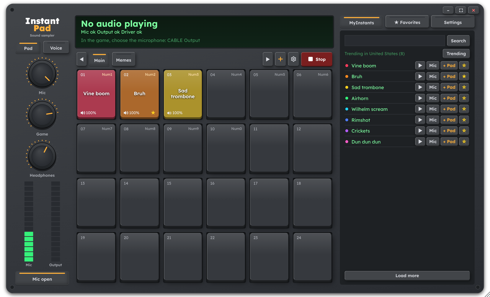
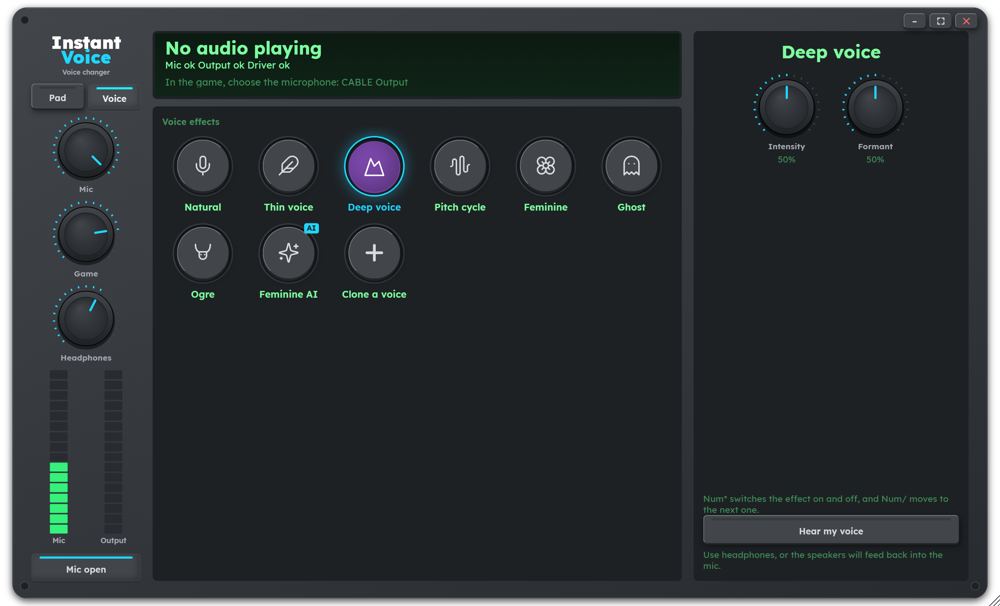
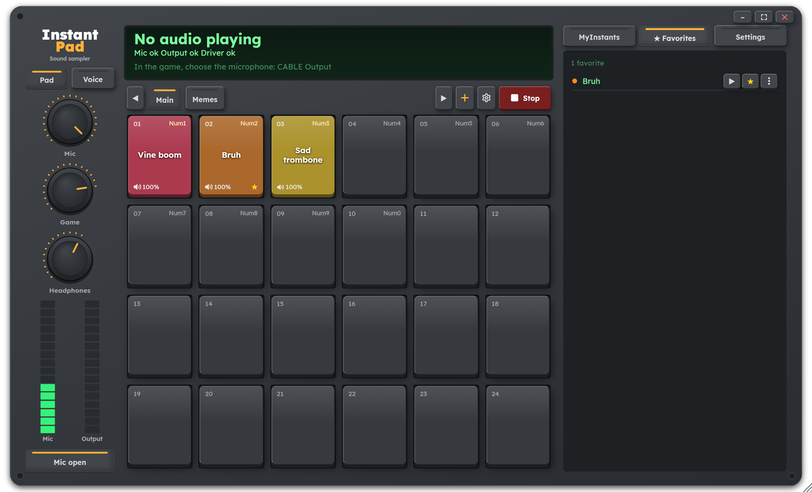
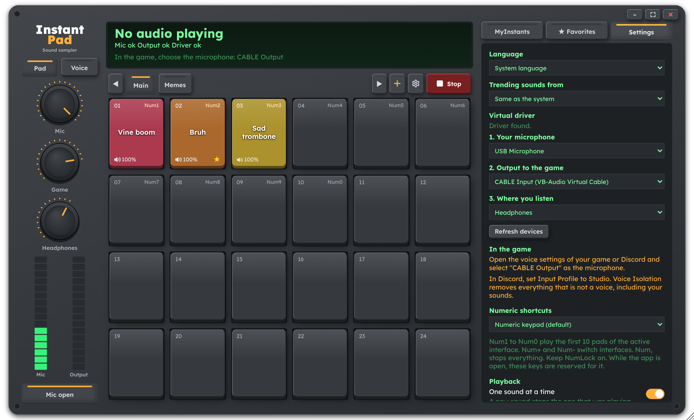

[English](README.md) | Português

<p align="center">
  <a href="assets/reel.mp4"></a>
</p>

# InstantPad

O InstantPad é um soundboard gratuito e de código aberto para Windows, macOS e Linux. Ele tem cara de sampler de hardware e traz a biblioteca do MyInstants embutida. O app mistura o seu microfone com os sons que você dispara e manda o resultado para um cabo de áudio virtual, que o jogo ou o Discord usa como microfone. Seus amigos ouvem a sua voz e o som juntos.



<p align="center">
  
  
  
</p>

## Instalação

### Por que você precisa de um cabo de áudio virtual

Jogos e Discord só escutam microfones. Um cabo de áudio virtual funciona como um microfone falso: tudo que um app toca numa ponta sai pela outra ponta como entrada de microfone. O InstantPad toca a sua voz e os seus sons no cabo, e você escolhe o cabo como microfone no jogo. No Windows e no macOS o cabo é um driver pequeno, instalado uma vez. No Linux o InstantPad cria o cabo para você.

```
microfone ─┐
           ├─► InstantPad ─► cabo virtual ─► jogo / Discord
sons ──────┤
           └─► seus fones (só os sons)
```

Baixe o arquivo do seu sistema na [última versão](https://github.com/eljonathas/InstantPad/releases/latest).

### Windows

1. Baixe o instalador `.exe` e execute. O app ainda não tem assinatura de código, então o Windows pode exibir um aviso na primeira vez. Clique em **Mais informações** e depois em **Executar assim mesmo**.
2. Depois de copiar o app, o instalador procura o VB-CABLE, o cabo virtual, e oferece instalá-lo se ele não estiver no PC. Clique em **Sim**. O Windows pede permissão de administrador, só para o driver, e a janela da VB-Audio abre: clique em **Install Driver**. O VB-CABLE é um donationware da [VB-Audio](https://vb-cable.com).
3. Escolha **Reiniciar agora** na última tela. O driver só funciona direito depois de reiniciar, e o InstantPad abre sozinho quando você entrar de novo.
4. O VB-CABLE se define como dispositivo de saída do Windows ao instalar. Abra as configurações de som do Windows e escolha seus fones como saída de novo. Enquanto a saída continuar no cabo, a tela **Ajustes** mostra um aviso com o botão **Abrir configurações de som**.

Se você pulou o driver na instalação, ou o removeu depois, vá em **Ajustes** e clique em **Instalar VB-CABLE**: o InstantPad baixa o driver do site oficial da VB-Audio, confere a assinatura e abre o instalador dele. Reinicie o PC em seguida.

Se preferir não instalar o app, baixe o `InstantPad-portable.exe`. Ele roda sozinho, não se atualiza e não tem instalador, então instale o VB-CABLE pelo botão em **Ajustes**.

### macOS

1. Baixe o instalador `.pkg` que combina com o seu Mac: `aarch64` para Apple silicon (M1 e mais novos), `x64` para Macs Intel.
2. O InstantPad ainda não é notarizado, então o macOS bloqueia o instalador na primeira vez. Abra os **Ajustes do Sistema**, vá em **Privacidade e Segurança**, clique em **Abrir Mesmo Assim** e abra o instalador de novo.
3. Deixe marcado **BlackHole 2ch (cabo de áudio virtual)** na etapa de tipo de instalação. O instalador baixa o pacote oficial do BlackHole da Existential Audio, confere e instala junto com o app. A opção fica cinza quando o BlackHole já está instalado.
4. Abra o InstantPad em Aplicativos e permita o acesso ao microfone quando o macOS perguntar.

Também dá para baixar o `.dmg` e arrastar o InstantPad para Aplicativos. Nesse caso, instale o [BlackHole 2ch](https://existential.audio/blackhole/) por conta própria: o botão **Instalar BlackHole** em **Ajustes** abre a página de download dele, e **Atualizar dispositivos** o encontra depois. No macOS o InstantPad não usa o VB-CABLE.

### Linux

1. Baixe o `.AppImage`, dê permissão de execução (`chmod +x` no arquivo, ou a opção de permissões do seu gerenciador de arquivos) e execute.
2. O InstantPad cria o próprio cabo virtual, chamado `InstantPad_Mic`, pelo PulseAudio ou PipeWire. Ele usa o comando `pactl`, então o `pactl` precisa estar instalado.

### Atualizações

O InstantPad procura uma versão nova ao abrir e baixa em segundo plano, conferindo a assinatura. A versão nova é aplicada quando você fecha o app, ou na hora com **Reiniciar agora** em **Ajustes**. Ele nunca reinicia sozinho, então uma atualização não interrompe sua partida.

## Configure o jogo ou o Discord

1. Abra o InstantPad e vá em **Ajustes**. A seção **No jogo** mostra o microfone a usar: `CABLE Output` no Windows, `BlackHole 2ch` no macOS e `InstantPad_Mic` no Linux.
2. Em **1. Seu microfone**, escolha o seu microfone de verdade. Em **3. Onde você ouve**, escolha seus fones. **2. Saída para o jogo** já deve apontar para o cabo.
3. Nas configurações de voz do jogo ou do Discord, selecione o cabo como microfone.
4. Toque um pad e pergunte a um amigo se ele ouviu, ou acompanhe o nível de entrada nas configurações de voz.

Se o jogo usa push-to-talk, segure a tecla enquanto o som toca, ou troque para microfone aberto.

No Discord, use o **Input Profile** **Studio**. O Voice Isolation remove tudo que não é voz, inclusive os seus sons. Se você usa um perfil personalizado, desligue a supressão de ruído, o cancelamento de eco e o controle automático de ganho.

## Como usar

| Para | Faça isto |
| --- | --- |
| Tocar um som | Clique no pad ou aperte o atalho dele |
| Encontrar sons | Busque no MyInstants ou abra **Em alta**, que mostra o que está popular no seu país. Em **Ajustes** dá para escolher outro país |
| Preencher um pad | Clique num pad vazio e depois em **+ Pad** num resultado, ou arraste o resultado até o pad. O som é baixado e fica salvo no seu computador |
| Testar um som online nos fones | O botão de play do resultado (**Ouvir só nos fones**) |
| Tocar um som online no jogo sem salvar | **Mic** no resultado (**Tocar no jogo agora**) |
| Favoritar | A estrela no resultado, ou botão direito num pad e **Favoritar** |
| Usar arquivos seus | Clique na tecla de pasta ao lado da busca e escolha um ou mais arquivos: eles vão para o pad que você clicou e para os próximos livres. Você também pode arrastar arquivos do gerenciador de arquivos até um pad, ou clicar com o botão direito num pad e escolher **Carregar arquivo de áudio...** |
| Guardar uma cópia do som em outro lugar | Botão direito no pad e **Baixar no computador...** |
| Mudar atalho, volume, cor ou nome de um pad | Botão direito no pad |
| Reorganizar os pads | Segure Ctrl e arraste |
| Parar tudo | **Parar** |
| Ocupar a tela inteira | A tecla de tela cheia ao lado de minimizar, ou `F11` |
| Girar um knob | Arraste para cima ou para baixo, ou use a roda do mouse. Clique duplo volta ao padrão. O valor exato aparece abaixo do knob enquanto você segura |

Os knobs ajustam a sua voz no jogo (**Mic**), os sons no jogo (**Jogo**) e os sons que você ouve (**Fones**).

Os sons que estão em pads e nos favoritos ficam salvos no seu computador. Os sons que você só ouviu vão para uma pasta temporária, que o InstantPad esvazia quando abre e quando fecha. Seus próprios arquivos podem ser `.mp3`, `.wav`, `.m4a`, `.aac` ou `.flac`. O formato `.wma` não é suportado.

Só uma cópia do app roda por vez. Abrir de novo traz a janela que já existe para a frente.

### Interfaces

Crie quantas interfaces quiser com **+**. Cada uma tem nome, cor e grade próprios, de até 8 linhas por 10 colunas. A engrenagem (**Configurar esta interface**) configura a interface atual, e o botão direito numa aba move ou exclui.

### Efeitos de voz

A tecla **Voice** abaixo do logo abre o InstantVoice, onde você muda a própria voz em chamadas e jogos. Clique num efeito para ligá-lo, e os knobs dele aparecem à direita. **Natural** desliga os efeitos. O efeito continua ligado quando você volta para **Pad**, e o LED da tecla **Voice** mostra que ele está ativo.

| Efeito | Knobs |
| --- | --- |
| Voz fina | **Intensidade** e **Formante** |
| Voz grossa | **Intensidade** e **Formante** |
| Variação de pitch, que sobe até um tom alto e desce até um baixo | **Tempo**, **Alto** e **Baixo** |
| Feminina, uma voz mais aguda, com ressonâncias e agudos realçados | **Intensidade** e **Formante** |
| Fantasma, um sussurro com eco oco | **Sussurro**, **Eco** e **Tom** |
| Ogro, uma voz grave e rosnada | **Intensidade**, **Rosnado** e **Formante** |
| Feminina IA, que muda o timbre da sua voz com IA | **Tom** |
| Cada voz que você clonar | **Tom** |

Ligue **Ouvir minha voz** para testar um efeito nos fones. Use fones nesse teste, porque caixas de som realimentam o microfone.

Um efeito atrasa sua voz em cerca de 40 ms. **Natural** não acrescenta atraso.

### Vozes com IA

**Feminina IA** e as vozes clonadas rodam um modelo de IA no seu próprio computador. Nada do que você fala sai dele. Na primeira vez, o app baixa os modelos, cerca de 180 MB, e a IA aprende a sua própria voz sozinha: na primeira vez que você escolhe uma voz de IA, ela escuta você falar por alguns segundos, sem gravar nada, e a voz liga quando termina. Se a primeira vez foi num lugar barulhento ou em outro microfone, **Aprender minha voz de novo** refaz isso. Uma voz com IA atrasa sua voz em cerca de um terço de segundo e precisa de um processador recente. Se o computador não acompanhar, o app avisa e mantém só a parte de tom do efeito.

### Clonar uma voz

A tecla **+** depois dos efeitos clona uma voz, para você falar com ela em chamadas e jogos:

1. Você grava de 20 segundos a 5 minutos de fala natural, sozinho num lugar silencioso, ou escolhe um arquivo de áudio com a voz.
2. Você dá um nome à voz.

O app guarda só a assinatura da voz. A gravação em si nunca é guardada. Selecione uma voz clonada e clique em **Excluir voz** para apagá-la quando quiser.

O app não confere de quem é a voz, então clone só a sua própria voz ou a de quem concordou. Usar a voz de alguém para se passar por essa pessoa pode ser crime, e a responsabilidade é de quem usa.

#### Dicas para um bom clone

A qualidade do clone depende quase toda da amostra. Grave num lugar silencioso e sem eco, com o microfone das chamadas a um palmo da boca. Fale com naturalidade e varie a entonação, como numa conversa. De 1 a 3 minutos de fala é o ideal, e menos de 30 segundos deixa a voz pobre. Se usar um arquivo, escolha um sem música de fundo e sem compressão forte, porque áudios de aplicativos de mensagem perdem detalhes. Na hora de usar, deixe a IA aprender a sua própria voz no mesmo microfone e ajuste o **Tom** até ficar perto da voz clonada. A IA copia o timbre, mas o ritmo e o jeito de falar continuam sendo seus.

### Criar uma voz personalizada

Depois que você tem uma voz clonada, a tecla depois de **Clonar uma voz** cria vozes novas a partir dela. Escolha a voz clonada de partida, leve o **Timbre** para uma voz mais grave ou mais aguda e, se quiser, misture outra voz clonada. Ligue **Ouvir prévia** para testar nos fones enquanto ajusta, depois dê um nome e salve. A voz personalizada guarda só a receita, então excluir uma voz clonada exclui também as vozes criadas a partir dela.

Comece com pouca mistura, entre 20% e 40%, e mexa no timbre aos poucos, ouvindo a prévia.

### Opções de reprodução

Em **Ajustes** há duas opções de reprodução:

- **Um som por vez**: um som novo interrompe o que estava tocando. Vem ligada em instalações novas. Uma atualização mantém a escolha que você já tinha.
- **Pressionar de novo para parar**, desligada por padrão: pressionar um pad que está tocando interrompe o som em vez de recomeçá-lo. O atalho do pad faz o mesmo.

Cada pad com som mostra o volume no canto inferior esquerdo. Clique com o botão direito no pad e escolha **Volume** para mudar. Em grades densas o pad omite o `%`. Em pads estreitos, o número e o atalho cedem a linha para o nome. Passe o mouse sobre o pad para ver o atalho e o volume completos.

### Atalhos numéricos

Vêm ligados por padrão e funcionam com o jogo em foco:

| Tecla | Ação |
| --- | --- |
| `Num1` a `Num9`, `Num0` | Os 10 primeiros pads da interface ativa |
| `Num+` / `Num-` | Próxima / anterior interface |
| `Num,` | Parar tudo |
| `Num*` | Ligar ou desligar o efeito de voz |
| `Num/` | Próximo efeito de voz |

Em **Ajustes** você pode trocar por `Ctrl` mais o teclado numérico, ou `Alt` mais `1` a `0`, ou desligar. Deixe o NumLock ligado. Um atalho definido num pad tem prioridade sobre esses.

### Idioma

O app segue o idioma do sistema e vem em português e inglês. Dá para mudar em **Ajustes**, em **Idioma**.

## Solução de problemas

Se o som está robótico, distorcido ou não aparece no Windows, primeiro veja se ele chega ao cabo. Abra o painel de som do Windows, vá em **Gravação** e observe a barra de nível do `CABLE Output` enquanto um pad toca. Se a barra se mexe, o problema está nas configurações do jogo ou do Discord. Se fica parada, o problema está no PC.

Confira nesta ordem:

1. Você reiniciou o PC depois de instalar o VB-CABLE? O Windows mostra o driver como funcionando antes da reinicialização, mas ele não está.
2. No Gerenciador de Dispositivos, procure uma entrada `VB-Audio Virtual Cable` com erro. Se houver, ou se o serviço de áudio do Windows fica parando, reinstale o driver: execute `VBCABLE_Setup_x64.exe` como administrador, clique em **Remove Driver**, reinicie, execute de novo, clique em **Install Driver** e reinicie.
3. O dispositivo de saída do sistema precisa ser os seus fones, não o cabo. Caso contrário, todos os apps do PC entram no seu microfone.
4. Fones Bluetooth caem para qualidade de chamada sempre que um app usa o microfone deles. Use um microfone com fio ou USB e confira se o Discord e o jogo não estão lendo o mic do fone.
5. Clique com o botão direito em `CABLE Input` e `CABLE Output` no painel de som do Windows e veja se os dois usam a mesma taxa de amostragem. O VB-CABLE distorce quando são diferentes. 48000 Hz funciona bem.
6. Abaixe os knobs **Mic** e **Jogo** até o medidor ficar fora do vermelho.

Outros casos:

- Os **Ajustes** dizem que nenhum cabo virtual foi encontrado: no Windows e no macOS, instale como descrito acima. No Linux, confira se o `pactl` está instalado.
- Um dispositivo que você acabou de conectar não aparece nas listas: clique em **Atualizar dispositivos** em **Ajustes**.
- Um atalho não faz nada enquanto um jogo roda como administrador: execute o InstantPad como administrador também.

## Desenvolvimento

Você precisa de Rust, Node 22 e pnpm. No Linux, também precisa das [bibliotecas de sistema do Tauri](https://tauri.app/start/prerequisites/).

```bash
pnpm install
pnpm dev
```

O [CONTRIBUTING.md](CONTRIBUTING.md) explica a estrutura do projeto, os testes e o padrão de commits. A pasta [docs/architecture](docs/architecture/README.md) descreve como o código é organizado.

## Limitações

No Windows o dispositivo virtual é o VB-CABLE, da VB-Audio. O Windows só carrega drivers de áudio assinados pela Microsoft, então o app não consegue criar o próprio. Ele baixa o instalador do site oficial e só o executa se a assinatura digital for da VB-Audio. O VB-CABLE é gratuito, com doação opcional.

No macOS o app e o instalador não são notarizados, então o macOS pede que você os libere na primeira vez. O instalador `.pkg` baixa o BlackHole para você; com o `.dmg`, você mesmo o instala.

O MyInstants não tem API pública, então o app lê o HTML do site. Se o site mudar, o arquivo a corrigir é o [`parser.rs`](crates/catalog/src/parser.rs).

Um jogo rodando como administrador pode bloquear atalhos globais. Nesse caso, execute o InstantPad como administrador também.

Algumas teclas dos teclados brasileiros ABNT2, como a `/` ao lado do Shift direito, não podem ser atalhos globais no Windows.

No Linux o cabo virtual continua depois que você fecha o app, até você encerrar a sessão, e a próxima abertura reaproveita o mesmo cabo.

As vozes com IA rodam no Windows, no macOS e no Linux de 64 bits para Intel ou AMD, só no processador. Elas não estão disponíveis no Linux ARM.

## Licença

[MIT](LICENSE). O app usa a fonte [Lexend](https://www.lexend.com/) sob a [SIL Open Font License](apps/desktop/src/shared/styles/fonts/OFL.txt).

As vozes com IA baixam estes modelos, que não fazem parte do app:

- [ONNX Runtime](https://onnxruntime.ai), da Microsoft, sob a licença MIT.
- O conversor de timbre do [OpenVoice V2](https://github.com/myshell-ai/OpenVoice), da MyShell, sob a licença MIT, na [exportação ONNX de Hinotsuba](https://huggingface.co/Hinotsuba/OpenVoice-ONNX-v2).

A voz da **Feminina IA** é a média de dez locutoras do [LibriSpeech](https://www.openslr.org/12) (Panayotov et al., CC BY 4.0), então não é a voz de nenhuma pessoa em particular.
